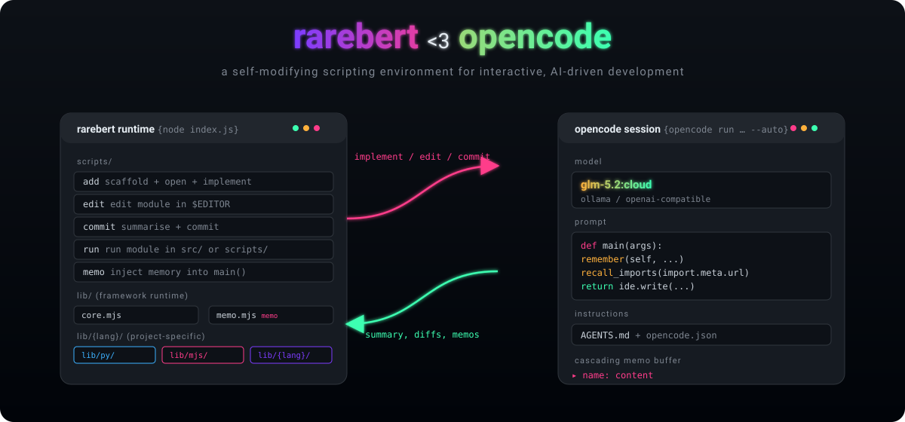
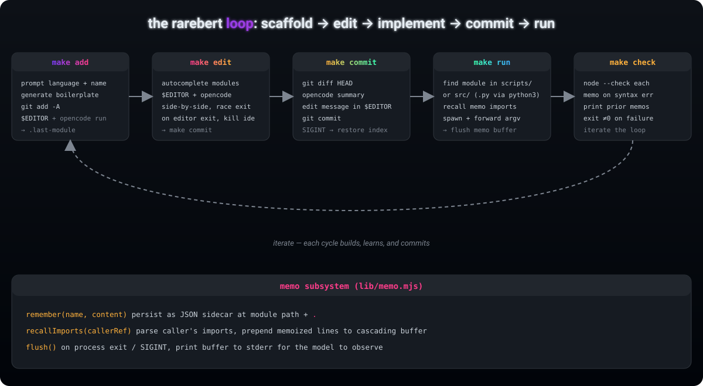

# rarebert <3 opencode

> ⚠️ **Work in Progress** — This branch (`refactor/bun-typescript-runtime`) is mid-port from Node.js/ESM to TypeScript/Bun. Not yet stable for daily use.



A self-modifying scripting environment for interactive, AI-driven
development. Rarebert scaffolds modules, opens them in your editor side-by-side
with [opencode], lets the model implement them, summarises the diff, and
commits — then runs the result and remembers what happened.

> Built around two pieces: a **TypeScript runtime** (`lib/runtime/` + Bun)
> that orchestrates `$EDITOR`, `git`, and `opencode`, and a **memo subsystem**
> that threads observations between the model and your shell.

## The loop



```sh
bun run dev                 # or: bun launch.ts (== rarebert <module>)
```

Each turn ends in a commit, so the working tree is always clean before the next
cycle. Memos from `check` (and any other script) surface on stderr the next
time the model is invoked, so failures teach the next attempt.

## Runtime

The runtime lives in `lib/runtime/` as TypeScript classes:

| File | Purpose |
|------|---------|
| `Module.ts` | Base class + free functions for abort/signal handling, terminal helpers |
| `CLI.ts` | Commander-powered CLI modules, `Arguments` Array subclass, `ExitSignal` |
| `TUI.ts` | Interactive TUI modules, `Interface` for stage-based flows |
| `Project.ts` | `Project`/`ProjectFolder` — module discovery and resolution |
| `Language.ts` | `Language`/`Languages` registry — multi-language support |
| `core.ts` | `exit()`, `AbortError`, `Store`, signal handler installation |

**Key design decisions:**

- **No `cli` singleton** — terminal helpers and abort/signal machinery are free
  functions in `Module.ts` (importable directly) or instance methods on
  `Module`/`CLI`/`TUI`. The legacy lowercase `cli` object was deleted.
- **No underscore methods** — all former `_private` methods are now public or
  removed. Dead code was eliminated.
- **Exit codes**: `EXIT_OK` (0), `EXIT_FAIL` (1), `EXIT_ABORT` (130).
- **Abort flow**: `abort()` and `nonInteractive()` route through `exit()` —
  messages go to stderr, never a raw `process.exit`. The only exception is
  the ctrl-c double-tap force-quit.

## Runtime cascade

Every script returns an `ExitSignal` from `exit()`. The cascade is:

```
main callback → return exit(code) or exit(new TUI(...))
  → Module.execute(result)
    → Runtime complete()       # resolves submodules, runs cleanup
      → process.exit(code)     # sole terminal exit point
```

- `exit(0)` — success
- `exit(1)` — failure
- `exit('error message')` — prints to stderr, exits 1
- `exit(new TUI(name, main, meta))` — delegates to a TUI submodule
- `exit(new CLI(name, main, meta))` — delegates to a CLI submodule

`AbortError` carries an `exitCode` for library functions that need to abort
without calling `process.exit()` directly. The cascade catches it and exits
with the appropriate code.

### TUI-delegation pattern

Interactive scripts use `return exit(new TUI(...))` to delegate from a CLI
callback to a full-screen TUI. The TUI's `execute()` guards against
non-interactive stdin automatically. See `scripts/analyze.ts` for the
canonical shape.

## Analyze & trace

`bun launch.ts analyze [module...]` (or `bun run dev -- analyze …`) introspects
the codebase:

```sh
bun launch.ts analyze [module...]              # condensed source map per module
bun launch.ts analyze [module...] --oneline    # one-line summary
bun launch.ts analyze [module...] --graph      # resolved import graph
bun launch.ts analyze --trace module::name     # forward dependency chain
bun launch.ts analyze --trace mod::outer::inner  # nested declaration trace
bun launch.ts analyze --usage module::name     # reverse: all project-wide references
bun launch.ts analyze --usage module::name --yes  # auto-memoize references
bun launch.ts analyze --document [module]      # opencode documentation pass
bun launch.ts analyze --clear-cache            # reset introspect cache
```

The `Trace` class (`lib/introspect.ts`) powers both directions:

- **`Trace.forward()`** — walks imports and declarations down the dependency
  chain from a binding to its roots. Supports `module::name` and nested
  `module::outer::inner::local` paths.
- **`Trace.usage()`** — reverse scan: finds every file:line that imports or
  re-exports a given binding across the entire project. Results can be
  memoized onto the target module with `--yes`.

## Repository layout

```
rarebert/
├── launch.ts                         # Composition root + data-driven dispatcher (entry point)
├── package.json
├── tsconfig.json
├── AGENTS.md
├── README.md
├── Makefile
├── .git/
├── .gitignore
├── .opencode/                        # Temporary/work scratches
├── lib/                              # Core library modules
│   ├── core.ts                       # exit(), AbortError, Store, signal handlers
│   ├── memo.ts                       # Memo management system
│   ├── introspect.ts                 # Trace class, buildGraph, traceBinding
│   ├── bindings.ts                   # Refactor engine, damage memos
│   ├── git.ts                        # Git operations wrapper
│   ├── backend.ts                    # Backend configuration
│   ├── ide.ts                        # Editor integration
│   ├── opencode.ts                   # opencode CLI wrapper
│   ├── server.ts                     # Server utilities
│   ├── models.ts                     # Data models
│   ├── editor.ts                     # lib/editor.ts
│   ├── module.ts                     # Test shim (explicit named re-exports)
│   ├── index.ts                      # Barrel exports (MainCallback, ModuleMeta…)
│   ├── supports/                     # Support modules
│   │   ├── symbols.ts                # Terminal symbols
│   │   ├── template.ts               # Template engine
│   │   ├── langjs.js                 # JavaScript language support
│   │   ├── langmjs.js                # MJS language support
│   │   ├── langts.js                 # TypeScript language support
│   │   └── langpy.js                 # Python language support
│   └── runtime/                      # Runtime layer (TypeScript)
│       ├── Module.ts                 # Module base class + free functions
│       ├── CLI.ts                    # CLI class, Commander wiring
│       ├── TUI.ts                    # TUI class, Interface/Stage
│       ├── Project.ts                # Project/ProjectFolder discovery
│       ├── Runtime.ts                # Runtime loop for submodule chains
│       ├── discovery.ts              # listAllModules, promptModule wiring
│       ├── Language.ts               # Language/Languages registry
│       ├── core.ts                   # ExitSignal, exit(), run(), Store
│       ├── libs.ts                   # Boilerplate generation
│       └── makefile.ts               # Makefile generation
└── scripts/                          # CLI command modules (Bunli commands)
    ├── analyze.ts                    # Source map, trace, usage scan
    ├── bunliprobe.ts                 # Bunli runtime-behavior probe (diagnostic)
    ├── check.ts                      # Syntax + integrity + memos
    ├── edit.ts                       # Module editor ($EDITOR + opencode)
    ├── fix.ts                        # Memo-guided fix session scaffold
    ├── list.ts                       # Module listing
    ├── memo.ts                       # Memo management CLI
    ├── open.ts                       # Open module in editor
    ├── refactor.ts                   # Multi-stage refactor orchestration
    ├── reload.ts                     # Regenerate Makefile
    ├── upgrades.ts                   # Upgrade management
    └── <stub>.ts                     # Stubs (unimplemented): add, install,
                                      #   languages, onboard, project, run,
                                      #   status, update — each header documents
                                      #   the original behavior (git history
                                      #   has the implementation). Removed in
                                      #   the Bunli slim-down: article, commit,
                                      #   diff, implement, present, trail, undo.
```

Key patterns:

- Every `scripts/*.ts` exports a default `new CLI('name.ts', main, meta)` instance
- Interactive branches delegate via `return exit(new TUI(name, main, meta))`
- The Bunli entry (`launch.ts`) registers every discovered module as a
  Bunli command (thin router) and runs it through the Runtime — Bunli only
  routes the command name; the module's own Commander parses its args
- `lib/memo.ts` provides the memo infrastructure used by multiple scripts

A **module** is a file inside one of a project's constituent folders — `./`,
`scripts/`, `lib/`, `lib/supports/`, or `src/`. `Project.discover()` returns
these folders, and every module is constructed from `(project, file)` via
`Module.fromProject()`. See [docs/modules.md](docs/modules.md) for the full
description and loading rules.

### Project-specific libraries: `lib/{lang}/`

The `lib/` root holds the framework runtime (`.ts` files imported by
`scripts/`). Project-specific libraries — the actual code your modules call —
live in language subdirectories:

```
lib/py/                 # python libraries, import via `from lib.py import X`
  __init__.py
  datasetloader.py
  postagger.py
lib/mjs/                # JS libraries, import via '../lib/mjs/X.mjs'
  ...
lib/{lang}/             # any installed language gets its own subdir
```

`make create` (python scaffolding) scans `lib/py/` for libraries and offers
them as preamble imports; `make add` (JS scaffolding) wires peer imports from
`lib/{lang}/` into the boilerplate. Install a new language with
`make languages install <lang>`.

## Setup

```sh
git clone https://github.com/akinevz2/rarebert
cd rarebert
bun install         # or: npm install
bun run dev          # start development
```

The package uses [Bun](https://bun.sh) as its runtime and package manager.
The `bin` entry point is `launch.ts`.

Then point `opencode.json` at your model. The default expects an
Ollama-compatible endpoint:

```jsonc
{
    "model": "ollama/glm-5.2:cloud",
    "provider": {
        "ollama": {
            "npm": "@ai-sdk/openai-compatible",
            "options": { "baseURL": "http://localhost:11434/v1" },
            "models": { "glm-5.2:cloud": { "name": "GLM 5.2 Cloud" } }
        }
    }
}
```

## Day-to-day

```sh
bun launch.ts list         # module listing (or `help`/`h`, or bare invocation)
bun launch.ts edit         # pick any module → $EDITOR + opencode → commit
bun launch.ts memo         # memo CLI (add / forget / drop / oldest / log)
bun launch.ts check        # syntax + integrity + memo sweep
bun launch.ts analyze …    # source map / trace / usage scan
bun launch.ts exec <ref>   # run a module by path reference (`exec scripts/foo.ts`)
```

Stubs (`add`, `install`, `languages`, `onboard`, `project`, `run`, `status`,
`update`) currently print an `` unimplemented `` error and exit 1; their
original behavior is documented in each stub's header and recoverable from
git history. The removed `article`/`commit`/`diff`/`implement`/`present`/
`trail`/`undo` loops return in later milestones or as external tooling.

### Memos

`lib/memo.ts` persists one-line observations as JSON sidecars
(`<modulepath>.`) and prepends them to a cascading buffer on the next run:

- `remember(name, content)` — append a memo
- `recallImports(import.meta.url)` — pull memos from a caller's imports
- `flush()` — on exit/SIGINT, print the buffer to stderr (the model sees it)

`bun launch.ts check` writes memos on syntax failures; `bun launch.ts memo`
injects `remember()` lines into a module's `main()` so they fire on every run.

## Testing

```sh
bun test               # run all tests
```

Tests live in `test/` and cover the runtime contract (arguments, dispatch,
exit signals, interface, lazy enquirer, runnability).

[opencode]: https://opencode.ai
[prettier]: https://prettier.io
[bun]: https://bun.sh